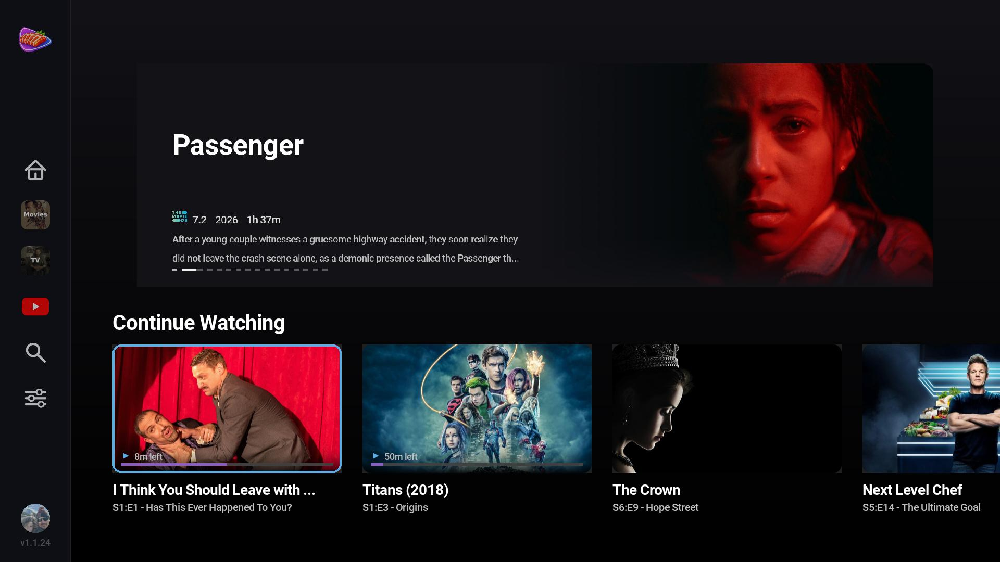
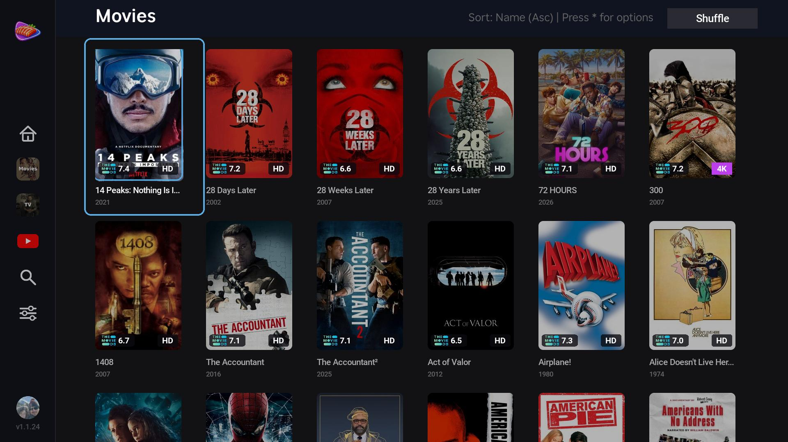
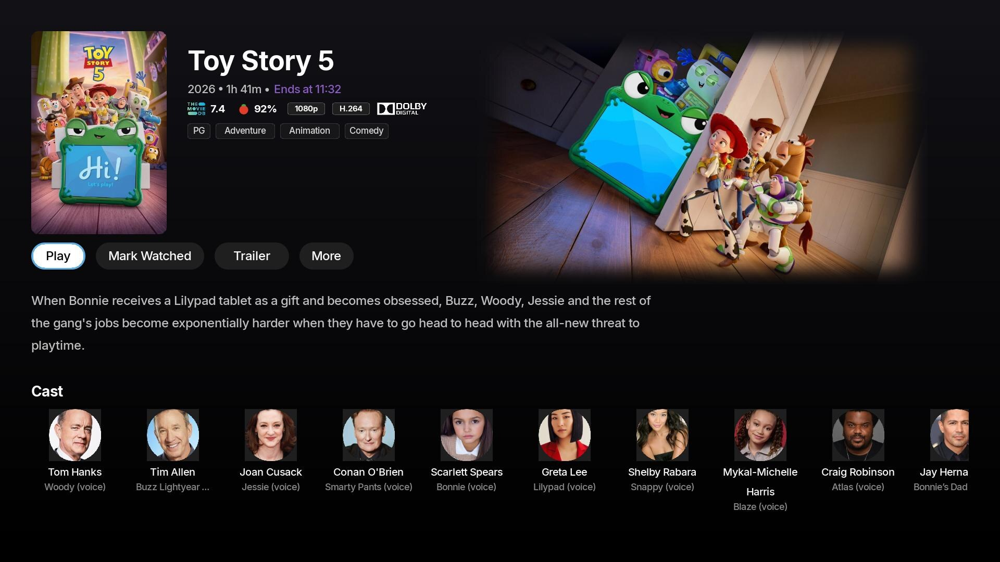
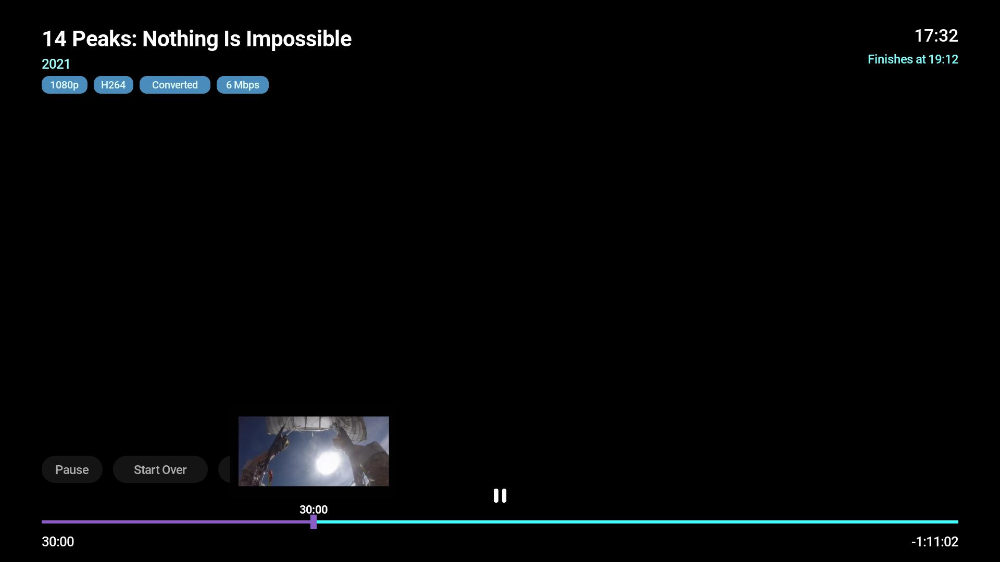

# Sashimi for Roku

<p align="center">
  
</p>

<p align="center">
  <strong>A native Jellyfin client for Roku</strong>
</p>

<p align="center">
  <a href="#screenshots">Screenshots</a> •
  <a href="#features">Features</a> •
  <a href="#get-more-out-of-sashimi">Server add-ons</a> •
  <a href="#requirements">Requirements</a> •
  <a href="#installing">Installing</a> •
  <a href="#settings">Settings</a> •
  <a href="#troubleshooting">Troubleshooting</a> •
  <a href="#development">Development</a> •
  <a href="#contributing">Contributing</a>
</p>

---

Sashimi is a Roku channel for [Jellyfin](https://jellyfin.org/) media servers,
written in BrightScript and SceneGraph. It talks only to the Jellyfin server you
point it at. There is no Sashimi account, no telemetry and no third-party
network traffic.

It is the Roku member of the Sashimi family. Sibling clients for
[Apple TV / iPhone / iPad](https://github.com/bitstorm-labs/sashimi-apple) and
[Android](https://github.com/bitstorm-labs/sashimi-android) live in their own
repositories.

## Screenshots



*Home — a hero banner that rotates through featured items, above Continue
Watching and a "Recently Added" row per library. The collapsed sidebar on the
left expands when focused.*



*Library — poster grid with quality and rating badges. The header shows the
active sort and filter; `*` opens the sort/filter menu, and Shuffle plays one
random item.*



*Detail — series logo art, action buttons, season pills and an episode row.
Movies use the same layout without seasons.*



*Player — stream info chips (resolution, codec, Original/Converted, bitrate), a
"Finishes at" estimate, and trick-play thumbnails while scrubbing.*

## Features

### Browsing

- **Pullout sidebar.** A collapsed icon rail that expands when focused (press
  LEFT). It holds Home, Stations (channels), your libraries, Search, Settings
  and an account row.
- **Home.** A rotating hero banner, **Continue Watching**, a **Stations** row if
  you have channels, and **Recently Added** per library. Reorder or hide rows in
  *Settings → Home Screen Rows*.
- **Continue Watching** merges in-progress items with Next Up, so a finished
  episode surfaces its successor, newest activity first, one entry per series.
- **Library grid** with sort (Name, Date Added, Release Date, Rating, Runtime),
  ascending/descending, and filters (All, Unwatched, Watched, Favorites). Press
  `*` for the menu. RIGHT from the grid opens an A-Z jump bar.
- **Shuffle.** UP from the top row of a Movies or TV library plays a random
  item. Series screens have their own Shuffle for a random episode.
- **Search** across movies and series, with your last 10 queries.
- **People.** Open a cast member to see what else they are in, across all your
  saved servers.
- **Quality and rating badges**, unplayed counts, watched checks and progress
  bars on cards.
- **YouTube-style libraries** (for example from Pinchflat) are detected by name
  and drawn with round channel avatars.

### Channels and the Guide

With the [Channels plugin](#get-more-out-of-sashimi), virtual channels show up
as a **Stations** row on Home and in the sidebar. Select a card to tune in to
what is airing now. The **Guide** is a scrolling timeline of channels and
programmes, and you can set a reminder for an upcoming airing.

Jellyfin administrators also get **Add to Channel** on movie and series screens
and **Manage Channels** on the Guide (rename, logos, remove titles, delete). It
needs Channels plugin 0.11 or newer. Dayparts and rules stay in the Jellyfin
dashboard.

### Detail screens

- **Play**, **Resume** (with **Start Over**), **Mark Watched**, **Shuffle**,
  **Series** (jump from an episode to its show), and a **More** menu with the
  full overview and the Favorite toggle.
- **Trailer button.** Appears when the item has a local trailer on the server,
  for example one downloaded by [Trailarr](https://github.com/nandyalu/trailarr).
  Remote and YouTube trailers are not supported.
- **Hero trailer.** After two seconds on a movie, series, season or episode
  screen, the backdrop fades to about 30 seconds of the local trailer, then
  back to the image. It plays once per visit and stops when you play something
  or leave. If the show's theme song is playing, the trailer waits for it to
  finish, because Roku can only play one stream at a time. Turn it off with
  **Play Trailers on Detail Screens**.
- **Theme songs.** A show's `theme.mp3` plays on its screens. Turn it off with
  **Play Theme Songs**.
- **Seasons and episodes.** Season pills, an episode row, a "More Episodes"
  strip, and a Cast row. Press `*` on a season for **Mark Season Watched /
  Unwatched**.
- **Show status** pill (Continuing, Ended, Upcoming), community and critic
  ratings, and resolution, codec and Dolby audio badges.

### Playback

- **Skip pill.** A "Skip Intro" or "Skip Credits" pill (also Recap and Preview)
  with a countdown fill, driven by Jellyfin's Media Segments. Optional auto-skip
  for intros and credits, both off by default.
- **Up Next.** At the end of an episode a card counts down to the next one, with
  Skip and Cancel. Auto-play next episode is on by default.
- **Adaptive quality.** In **Auto**, Sashimi measures your connection and picks
  a bitrate, holds Wi-Fi to a lower ceiling, remembers the link between
  sessions, and steps back up when it can. A stream that stalls steps down from
  the same position (20, 8, 4, 2, 1 Mbps, 720 kbps) and says so on screen.
  *Always Play Original* turns the automatic fallbacks off.
- **HEVC and Dolby Vision without re-encoding.** When only the audio or
  container needs changing, the server remuxes and keeps the original video, so
  HEVC and Dolby Vision sources keep their quality. Surround audio goes out as
  Dolby where your device supports it.
- **Quality menu** in the player: Auto plus six tiers from 1080p at 20 Mbps
  down to 360p at 720 kbps. The menu marks the quality in force.
- **Trick-play scrubbing** with thumbnails from Jellyfin's trickplay sheets, and
  **chapters** with tick marks on the scrub bar. Accelerating seek steps
  10, 20, 40, 60 seconds.
- **Audio and subtitle tracks.** Subtitles are burned in by the server, so SRT,
  styled ASS and image-based PGS all work. Changing them restarts the stream.
  Roku's system caption On/Off setting is honoured.
- **View modes.** Normal, Zoom (crop) or Stretch, per session or as a default.
- **Stream info** on the overlay: resolution, codec, Original or Converted,
  bitrate, and a "Finishes at" estimate.
- **Progress reporting** to Jellyfin on start, every five seconds, on pause and
  on stop, so resume works across all your clients.

### Server dashboard and remote control

- **Server Dashboard** (*Settings → Server Dashboard*, Jellyfin administrators
  only). Now-playing cards for every active stream: who, on what device, direct
  play or converting (and why), progress, and local or remote. Plus storage,
  health and recent activity. OK on a card can **Stop** the stream or **Message**
  the viewer.
- **Receiving Stop and Message.** Sashimi also accepts those commands from the
  Jellyfin dashboard on the Roku it is running on. This needs **Roku OS 16 or
  newer** (it uses the `roWebSocket` API). On older firmware the feature is
  quietly off and everything else works.

### Connecting

- **LAN discovery** with Jellyfin's standard UDP 7359 probe, or enter an
  address by hand.
- **Multi-server.** Add several servers and switch from the sidebar or
  *Settings → Servers*.
- **Deep linking** through Roku's ECP. `movie`, `episode`, `series` (resolved
  to your next unwatched episode) and similar types start playback at once.
  `season` opens its detail screen.

## Get more out of Sashimi

Sashimi works with a stock Jellyfin server. These add-ons make it better. None
is required. The first three are made by Bitstorm Labs. The last two are separate
projects by other people; see [Acknowledgments](#acknowledgments).

| Add-on | What you get in Sashimi on Roku | Without it |
|---|---|---|
| **[Continue Watching](https://github.com/bitstorm-labs/jellyfin-plugin-continue-watching)** plugin | One server-ranked Resume + Next Up row, in the same order on every Sashimi client. | The Roku builds the row itself from Resume and Next Up. Same idea, ranked on the device. |
| **[Channels](https://github.com/bitstorm-labs/jellyfin-plugin-channels)** plugin | 24/7 virtual channels: the Stations row, the Guide and reminders, plus Add to Channel and Manage Channels for admins. | No Stations row or Guide. |
| **[Theme Songs](https://github.com/bitstorm-labs/jellyfin-theme-songs)** plugin | Downloads `theme.mp3` per series. Sashimi plays it on series screens. Setting: *Play Theme Songs*. | Silence on series screens. Shows with no theme file are always silent. |
| **[Intro Skipper](https://github.com/intro-skipper/intro-skipper)**, by the Intro Skipper team (not Bitstorm Labs) | Detects intros and credits. Sashimi reads them through Jellyfin's native Media Segments and shows the Skip pill and optional auto-skip. | No skip pill. |
| **[Trailarr](https://github.com/nandyalu/trailarr)**, a separate app by nandyalu (not Bitstorm Labs) | Downloads local trailers. Sashimi shows a Trailer button and plays hero trailers on detail screens. | No trailer button or hero trailer. |

Also on the server side:

- **Hardware transcoding** (QSV, NVENC, VAAPI) makes Auto quality, burned-in
  subtitles and trailer playback much smoother.
- **Trickplay image extraction**, enabled per library, gives you thumbnails
  while scrubbing.

## Requirements

- A Roku device. Remote Stop and Message need Roku OS 16 or newer; the rest of
  the app does not.
- A Jellyfin server, version 10.10 or newer. Sashimi is developed against
  10.11.x.
- To build it yourself: Node.js 20 and a Roku in Developer Mode (see
  [Roku's guide](https://developer.roku.com/docs/developer-program/getting-started/developer-setup.md)).

## Installing

Sashimi is not in the Roku Channel Store. Install it by sideloading:

1. On your Roku: **Settings → System → Advanced system settings → Developer
   options**, and enable Developer Mode. Set a developer password when prompted.
2. Download `sashimi-roku-<version>.zip` from the
   [latest release](https://github.com/bitstorm-labs/sashimi-roku/releases).
3. Browse to `http://<your-roku-ip>` from a computer on the same network and
   sign in with the developer password.
4. Upload the zip and press **Install**, then launch Sashimi.

> Sideloaded channels are removed when the Roku reboots out of developer mode,
> and only one sideloaded channel can be installed at a time.

On first run, press **Discover Servers** or type your server's address (for
example `http://192.168.1.100:8096`), then enter your Jellyfin username and
password.

## Settings

| Setting | Default | Notes |
|---|---|---|
| **Servers** | — | Add, switch between, or remove servers. `*` removes the highlighted one. |
| **Server Dashboard** | — | Jellyfin administrators only. See Features. |
| **Home Screen Rows** | — | LEFT/RIGHT reorder, OK shows/hides, Back saves. Visit Home once first so your libraries are known. |
| **Maximum Bitrate** | Auto | Auto, or cap at 4K (80 Mbps), 1080p (20), 720p (8), 480p (4), 720p (2), 480p (1) or 360p (720 kbps). From 20 Mbps down each also caps resolution. Auto measures your connection and adapts; see Playback. |
| **Always Play Original** | Off | Requests direct play and disables the adaptive HLS and bitrate-step-down fallbacks. |
| **Auto-Play Next Episode** | On | |
| **Auto-Skip Intro** | Off | Needs intro/credit markers on the server (Intro Skipper). |
| **Auto-Skip Credits** | Off | Needs intro/credit markers on the server (Intro Skipper). |
| **Resume Threshold** | 30 seconds | How far in you must be before Sashimi offers to resume rather than start over. |
| **Default View Mode** | Normal | Normal, Zoom or Stretch. A mode picked in the player overrides it for the rest of that session; changing it here replaces that pick. |
| **TV Shuffle** | Random Episode | What Shuffle on a TV library plays: a random episode, or a random show's next episode. |
| **Audio Language** | Default | Preferred audio track language. |
| **Subtitles On By Default** | Off | Selects the first subtitle track when playback starts. |
| **Subtitle Language** | Default | Preferred subtitle track language. |
| **24-Hour Time** | Off | Affects the player clock, "Finishes at" and "Ends at". |
| **Show Quality Badges** | On | 4K / HD / SD badges on artwork. |
| **Show Review Ratings** | On | Community ratings on artwork. |
| **Use Episode Ratings** | Off | When off, episode tiles show the series rating. |
| **Play Theme Songs** | On | A show's theme song on its detail screens (needs `theme.mp3` files, e.g. from the Theme Songs plugin). |
| **Play Trailers on Detail Screens** | On | The hero trailer described under Detail screens. |
| **Version** | — | Read-only. |
| **Sign Out** | — | Clears stored credentials and asks the server to revoke the token. |

## Troubleshooting

### No trick-play thumbnails while scrubbing

Jellyfin does not serve BIF files, so Sashimi draws its own previews from
Jellyfin's trickplay tile sheets. If those images have not been generated there
is nothing to draw, and scrubbing simply works without previews.

Generate them in Jellyfin: **Dashboard → Libraries → (your library) → Manage
Library**, enable **trickplay image extraction**, then run a library scan. The
images are produced by a background task and can take a long while on a large
library.

Previews are also deliberately skipped for anything **shorter than 15 minutes**,
and only appear while you are actively seeking — opening the overlay without
pressing LEFT or RIGHT shows the scrub bar alone.

### Playback buffers, stalls, or drops in quality

Most often this is bandwidth. A remote Jellyfin server can only send what its
**upload** connection can push, and a direct-played 4K remux will easily exceed
a typical home upstream.

- Lower **Settings → Maximum Bitrate** to something the link can sustain.
- Leave **Always Play Original** off. It disables the automatic fallbacks that
  would otherwise retry over HLS and step down as far as 360p · 720 kbps.
- *Lowering quality for your connection…* means Sashimi is already stepping
  down; the Quality menu shows where it landed and lets you pick another tier.
- Server-side hardware transcoding (QSV, NVENC, VAAPI) makes a large difference,
  especially with burned-in subtitles.

### "Discover Servers" finds nothing

Discovery is one UDP broadcast to port **7359** with a roughly three-second
listening window. It will not find your server if:

- The Roku and the server are on **different subnets or VLANs** — broadcasts do
  not cross them.
- A **firewall** on the server host blocks inbound UDP 7359.
- Jellyfin's own auto-discovery is turned off (**Dashboard → Networking**).
- The server is **remote** rather than on the same LAN.

In all of these cases, enter the address manually. Discovery is a convenience,
not a requirement.

### Cannot connect to an HTTPS server

Sashimi validates certificates against Roku's stock public CA bundle and offers
no way to trust a **self-signed or private-CA certificate**. If your server uses
one, either connect over `http://` on your LAN or put Jellyfin behind a reverse
proxy with a publicly trusted certificate.

### `http://` sends your credentials in cleartext

Over plain HTTP your password at sign-in, your access token, and the trick-play
image requests that carry that token as a query parameter all cross the network
unencrypted. That may be an acceptable trade on a trusted home LAN. **Use HTTPS
for any server reachable from outside your home.**

### Nothing plays at all

Check the server from another client first. If Sashimi shows *Playback error*,
the dialog includes a numeric Roku error code — please include it when reporting
an issue. Release builds keep logging sparse on purpose, so titles, tokens and server URLs never reach the debug console (port **8085**).

### "Session expired — please sign in again"

Your Jellyfin token was revoked or the server stopped accepting it. Sign out and
back in from *Settings*.

## Known limitations

### Subtitle changes restart the stream

Roku's native HLS-VTT subtitle rendering fails silently, so Sashimi asks Jellyfin
to **burn subtitles into the video** instead. That is why every format works
identically — SRT, ASS with styling tags, and image-based PGS — but it has real
costs:

- Turning subtitles on or off, or switching tracks, **restarts the stream**, so
  expect a short re-buffer.
- The server **must transcode** while subtitles are on, even for a file that
  would otherwise direct-play. This overrides *Always Play Original*.
- Roku's *"On instant replay"* and *"When mute"* caption modes are deliberately
  ignored, because a burned-in track cannot follow a mode that changes
  mid-playback. Plain **On** and **Off** are honoured.

### Other

- **Search covers movies and series only** — not individual episodes, people,
  music or collections.
- **Library grids list movies and series**, not individual episodes; reach
  episodes through a series' detail screen.
- **English only.** Every string is hardcoded; there is no translation layer yet.
- **Tests cover pure logic only** (`npm test`: quality tiers, the step-down
  ladder, the bandwidth-probe arithmetic). Everything that touches the screen,
  the player or the network is verified by sideloading onto a real device.
- Sashimi is **not yet in the Roku Channel Store**, so sideloading is the only
  install path today.

## Known limitations

- **Subtitle changes restart the stream.** Roku's native subtitle rendering
  fails silently, so the server burns subtitles into the video. Every format
  works, but toggling or switching tracks re-buffers, and the server must
  transcode while subtitles are on. Roku's "On instant replay" and "When mute"
  caption modes are ignored.
- **Search covers movies and series only.** Library grids list movies and
  series, not single episodes.
- **English only.**
- **Not in the Channel Store**, so sideloading is the public install path.

## Development

```bash
npm install
npm run lint      # BrighterScript static analysis, no zip
npm test          # off-device unit tests (pure logic only)
npm run package   # build out/sashimi-roku.zip and copy to sashimi.zip

export ROKU_DEV_TARGET=<your Roku's address>
export ROKU_DEV_PASSWORD=<Developer Mode password>
npm run dev       # package + sideload
```

The debug console is on telnet port **8085** (`nc <roku-ip> 8085`). Attach
after sideloading, because replacing the channel drops the connection.

`CLAUDE.md` documents the platform traps this codebase works around. Read it
before changing rendering code.

```
source/        Main.bs (entry, deep links) and utils/ (pure logic, tested)
components/    MainScene, screens/, widgets/, tasks/ (JellyfinApi, discovery, remote control)
tests/         Off-device unit tests
docs/          README screenshots
images/ fonts/ locale/ scripts/
manifest       Channel metadata and version
```

## Releasing

CI (`.github/workflows/build.yml`) lints, tests and packages every push and pull
request. Pushing a `v*.*.*` tag publishes a GitHub Release with the sideload zip.

The signed `.pkg` for Roku's beta channel is a separate manual step, because
Roku signs only on a physical device. Bump `build_version` in `manifest`, then
run `bash scripts/package-signed.sh` against a dev Roku. It writes
`out/sashimi-signed-<version>.pkg`, which is uploaded by hand under **Package
Upload** at [developer.roku.com](https://developer.roku.com/).

## Contributing

See **[CONTRIBUTING.md](CONTRIBUTING.md)**. In short: branch, use
[Conventional Commits](https://www.conventionalcommits.org/), get `npm run lint`
and `npm test` clean, test on a real Roku, and say in the PR what you ran. If
you plan something large, open an issue first.

## Security and privacy

Sashimi collects nothing: no analytics, telemetry, crash reporting or ads. Your
credentials and preferences stay in the Roku registry on your device.

- **[PRIVACY.md](PRIVACY.md)**: what is stored and what leaves the device.
- **[SECURITY.md](SECURITY.md)**: how to report a vulnerability privately.
- **[TERMS.md](TERMS.md)**: terms of use.

## License

MIT. See [LICENSE](LICENSE).

## Acknowledgments

Sashimi is built on, and works with, other people's projects. Each one is a
separate project under its own license. Sashimi is not affiliated with or
endorsed by any of them, nor by Roku, Inc.

**The server**

- [Jellyfin](https://jellyfin.org/) (the Jellyfin project, GPL-2.0). The free
  software media system Sashimi is a client for.

**Server add-ons Sashimi works with** (not made by Bitstorm Labs)

- [Intro Skipper](https://github.com/intro-skipper/intro-skipper) (by the Intro
  Skipper team, GPL-3.0). Detects intros and credits. Sashimi reads the
  segments it writes to Jellyfin and shows the Skip pill.
- [Trailarr](https://github.com/nandyalu/trailarr) (by nandyalu, GPL-3.0).
  Downloads trailers next to your media. Sashimi plays them on detail screens.

**Tools and assets**

- [BrighterScript](https://github.com/rokucommunity/brighterscript) and
  [roku-deploy](https://github.com/rokucommunity/roku-deploy) (RokuCommunity, MIT).
  Compile, package and deploy the channel.
- [brs](https://github.com/rokucommunity/brs) (RokuCommunity, MIT). Runs the
  unit tests off-device.
- [Inter](https://github.com/rsms/inter) (rsms and contributors, SIL Open Font
  License 1.1). The channel's typeface, bundled in `fonts/`.

The TMDb and Rotten Tomatoes logos next to ratings belong to their owners. The
ratings themselves come from your Jellyfin server.
